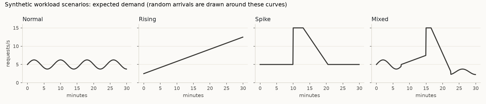
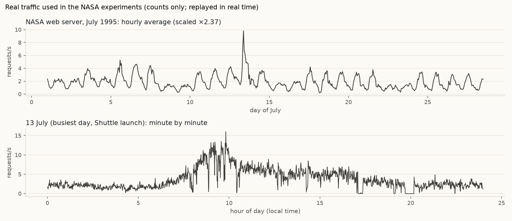
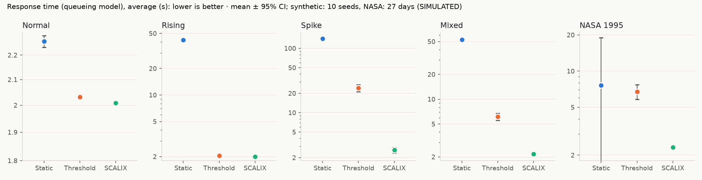
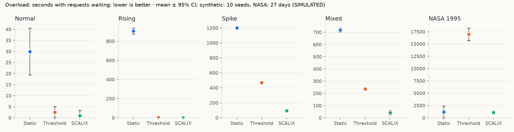
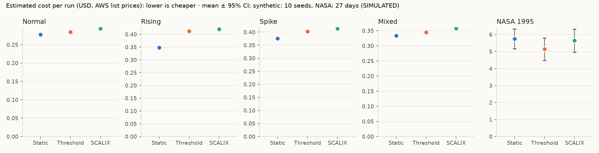
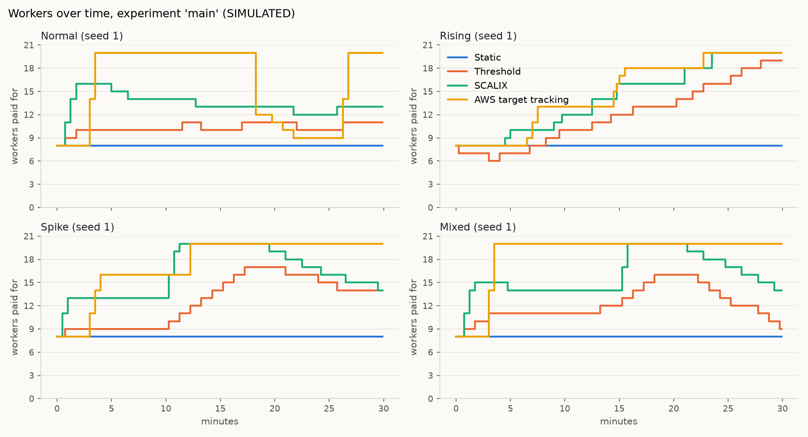
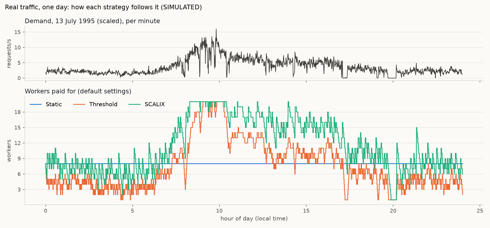

# Evaluation: methodology and results

> **All results in this document are SIMULATED.** They come from the local simulator described in [SIMULATION.md](SIMULATION.md), and none is an AWS measurement. No AWS infrastructure was deployed, nothing contacted AWS, and no real cloud performance improvement is claimed.
>
> * **Response times** come from a queueing model, not measured latency.
> * **Costs** are estimates from AWS list prices for a t3.micro in us-east-1, including T3 CPU credits. They are not AWS bills.

Every number below comes from the experiment outputs in `results/experiments/` and `results/tuning/tuned.json`. The tables in this file are filled in from those outputs by `python -m scalix.evaluation_doc`, from the prose in `EVALUATION.template.md`, and a test checks that they still match. The full set of tables is in [results/RESULTS_TABLES.md](results/RESULTS_TABLES.md), built by `python -m scalix.evaluation report`.

**What changed in Phase 7.** Phase 6 left six limitations. This version fixes the five that need no AWS:

| Phase 6 limitation | Phase 7 change | Where |
|---|---|---|
| The response proxy sat at 2.00 s whenever no queue formed | An M/M/c (Erlang C) queueing model that shows waiting at 60–90% load | [SIMULATION.md §3.1](SIMULATION.md#31-response-time-the-queueing-model-phase-7) |
| Illustrative USD 0.10 per worker-hour | AWS list prices for one t3.micro per worker, plus IPv4, storage and T3 CPU credits | [SIMULATION.md §3.2](SIMULATION.md#32-cost-aws-list-prices-phase-7) |
| Untuned settings | Each strategy tuned on separate training seeds, then tested on the usual seeds and on real traffic | §5 below |
| Synthetic workloads only | 27 real days of the NASA web server log, July 1995 | [SIMULATION.md §1.1](SIMULATION.md#11-real-traffic-the-nasa-web-server-log-july-1995-phase-7) |
| SCALIX needed a load balancer's request rate on AWS | A CPU-derived demand signal, tested in simulation and wired into the AWS controller | §6 below, [CONTROLLER.md](CONTROLLER.md) |

The sixth limitation, no AWS deployment, is unchanged: that's the next phase, and each step of it needs your approval.

## 1. Question and expectation

**Question:** compared with a fixed fleet (Static) and a classic reactive rule (Threshold), does workload-aware scaling (SCALIX) give a better balance between responsiveness and resource use?

**Expectation stated before running (Phase 1):** acting early and in larger steps should cut waiting under changing demand, but it also means more workers and so more cost. SCALIX was **not** assumed to win.

## 2. Method

### 2.1 Experiment suite (fixed in code before running)

The suite is defined in `scalix/evaluation.py` (`SUITE`), and every experiment runs all three strategies.

* **Synthetic experiments:** 4 scenarios × 10 test seeds (1–10). Each run is 30 minutes of simulated time in 5 s steps, with a decision every 15 s.
* **NASA experiments:** every complete day of July 1995 (days 1–27). Each run is a full 24 hours replayed in real time.

That's **1,164 runs** in total. Tuning added 9,520 training runs on other seeds: 238 settings × 4 scenarios × 10 seeds.

| Experiment | What changes | Question |
|---|---|---|
| `main` | nothing (defaults) | How do the three strategies compare? |
| `slow-startup` | new workers take **120 s** to start (default 30 s) | Does the comparison hold with a more realistic EC2 start-up time? |
| `scalix-target-70` | SCALIX's target utilization **0.70** (default 0.60) | Is SCALIX's extra capacity caused by its lower target? |
| `scalix-no-additions` | SCALIX without spike detection, scaling down after 1 low interval (the original Java behaviour) | What do the two Python additions contribute? |
| `queue-cap-0.99` | the queueing model's utilization cap raised from 0.95 to 0.99 | Does the cap change any conclusion? |
| `tuned` | every strategy at its **tuned** settings (§5) | How do they compare when each is set up as well as it can be? |
| `cpu-signal` | SCALIX's demand signal from **CPU only** (no load balancer) | How much does SCALIX lose without a request-rate signal? |
| `nasa` | **real traffic**, default settings | Do the results hold on real web traffic? |
| `nasa-tuned` | real traffic, tuned settings | Do the tuned settings, chosen on synthetic training seeds, hold on real traffic? |
| `nasa-cpu-signal` | real traffic, CPU-only signal | Same as `cpu-signal`, on real traffic |
| `nasa-aws` | real traffic with **AWS-like timing**: a decision every 5 minutes (CloudWatch basic monitoring), 120 s start-up, CPU-only signal | Which strategy should the AWS controller use? |

### 2.2 Fairness controls

* **Identical traces.** For each scenario and seed (or day), one workload trace is generated once and given unchanged to every strategy. Experiments with the same workload settings share traces, so their variants can be compared seed by seed.
* **Same start.** Threshold and SCALIX always start at 8 workers with limits 1–20. Static's fleet size is its only setting: 8 by default, and its tuned size in the tuned experiments.
* **Test seeds are never training seeds.** Tuning used seeds 101–110. The test seeds (1–10) and the NASA days were never used for tuning, and a test checks this.
* **No cherry-picking.** Seeds, days, settings and the tuning rule were fixed before running. All runs are reported, and none was dropped or re-run.

### 2.3 Workloads

Base demand is 5 requests/s:

* **Normal:** ±25% sine wave.
* **Rising:** straight line from 2.5 to 12.5 req/s.
* **Spike:** jump to 15 req/s at minute 10, then a decline.
* **Mixed:** all three in sequence.

Arrivals are random (Poisson).



**NASA 1995** is real per-5-second request counts from NASA Kennedy Space Center's web server, scaled ×2.37 so the busiest minute of the month is 80% of the 20-worker maximum. It has daily cycles, quiet weekends and the 13 July Space Shuttle launch peak. It also has a 22-minute gap with no requests on the evening of 13 July and shorter ones on other days, probably logging or server outages; they're replayed as zero demand.



### 2.4 Metrics and statistics

These are as defined in [SIMULATION.md](SIMULATION.md#3-metrics-per-run).

* **Response time:** the queueing-model average and p95. An idle system already has a p95 of about 6 s, because service times are exponential with a 2 s mean.
* **Cost:** estimated USD per run, shown with and without the T3 CPU-credit part.
* **Overload:** time with requests waiting.

Cells show the **mean ± the half-width of the 95% confidence interval** (Student t). Two kinds of comparison are used:

* **Unpaired:** "clear" = the best strategy's interval doesn't overlap any other.
* **Paired by seed or day** (§3.3): strategies saw the identical trace, so their per-seed differences are compared. This matters on NASA, where days differ far more from each other than strategies do.

### 2.5 Reproduce

```bash
.venv/bin/python -m scalix.tuning run
.venv/bin/python -m scalix.evaluation run
.venv/bin/python -m scalix.evaluation report
```

1. **Tuning:** about 3 minutes. It writes `results/tuning/`.
2. **Evaluation run:** about 6 minutes on 2 CPUs. NASA days are long.
3. **Report:** rebuilds the tables and figures. Then `.venv/bin/python -m scalix.evaluation_doc` refills this file's tables.

Runs are deterministic, so the CSVs come out identical every time.

## 3. Results with default settings

### 3.1 Synthetic scenarios (`main`)

Seeds 1–10 (10 runs per scenario and strategy). Mean ± 95% CI.

| Scenario | Strategy | Resp. avg (s) | Resp. p95 (s) | Overload (s) | Cost (USD) | Cost, no credits (USD) | Worker-min | Avg util | Ups | Downs |
|---|---|---|---|---|---|---|---|---|---|---|
| Normal | Static | 2.26 ± 0.03 | 6.65 ± 0.07 | 30 ± 11 | 0.277 ± 0.002 | 0.065 ± 0.000 | 240 ± 0 | 63.1% ± 0.6% | 0.0 ± 0.0 | 0.0 ± 0.0 |
| Normal | Threshold | 2.03 ± 0.01 | 6.05 ± 0.03 | 2 ± 3 | 0.285 ± 0.003 | 0.084 ± 0.002 | 308 ± 6 | 49.9% ± 0.9% | 4.6 ± 0.5 | 2.2 ± 0.6 |
| Normal | SCALIX | 2.01 ± 0.00 | 6.01 ± 0.02 | 1 ± 2 | 0.294 ± 0.003 | 0.107 ± 0.004 | 395 ± 13 | 39.5% ± 1.2% | 4.3 ± 1.0 | 4.6 ± 1.2 |
| Rising | Static | 42.15 ± 2.15 | 208.16 ± 8.52 | 906 ± 31 | 0.348 ± 0.001 | 0.065 ± 0.000 | 240 ± 0 | 80.7% ± 0.4% | 0.0 ± 0.0 | 0.0 ± 0.0 |
| Rising | Threshold | 2.04 ± 0.01 | 6.07 ± 0.01 | 2 ± 2 | 0.413 ± 0.002 | 0.098 ± 0.001 | 362 ± 2 | 61.8% ± 0.6% | 12.2 ± 0.3 | 1.2 ± 0.3 |
| Rising | SCALIX | 2.00 ± 0.00 | 6.00 ± 0.00 | 0 ± 0 | 0.421 ± 0.003 | 0.120 ± 0.003 | 441 ± 9 | 50.4% ± 1.1% | 7.1 ± 0.7 | 0.2 ± 0.3 |
| Spike | Static | 140.65 ± 4.54 | 295.79 ± 6.67 | 1201 ± 2 | 0.376 ± 0.002 | 0.065 ± 0.000 | 240 ± 0 | 87.6% ± 0.4% | 0.0 ± 0.0 | 0.0 ± 0.0 |
| Spike | Threshold | 24.13 ± 3.00 | 72.73 ± 7.85 | 470 ± 20 | 0.403 ± 0.003 | 0.104 ± 0.001 | 382 ± 5 | 59.4% ± 0.8% | 9.7 ± 0.3 | 4.1 ± 0.6 |
| Spike | SCALIX | 2.64 ± 0.27 | 9.08 ± 1.98 | 96 ± 13 | 0.414 ± 0.003 | 0.131 ± 0.002 | 484 ± 8 | 45.7% ± 1.0% | 4.9 ± 0.5 | 5.0 ± 0.5 |
| Mixed | Static | 52.88 ± 2.30 | 173.76 ± 6.53 | 718 ± 18 | 0.333 ± 0.002 | 0.065 ± 0.000 | 240 ± 0 | 77.0% ± 0.5% | 0.0 ± 0.0 | 0.0 ± 0.0 |
| Mixed | Threshold | 6.14 ± 0.58 | 22.79 ± 2.32 | 236 ± 10 | 0.345 ± 0.002 | 0.095 ± 0.002 | 351 ± 6 | 53.3% ± 0.7% | 8.4 ± 0.5 | 8.0 ± 0.7 |
| Mixed | SCALIX | 2.17 ± 0.09 | 6.48 ± 0.33 | 42 ± 18 | 0.358 ± 0.002 | 0.129 ± 0.002 | 475 ± 8 | 40.1% ± 0.8% | 5.6 ± 0.5 | 6.9 ± 0.6 |






1. **Sudden changes (Spike, Mixed): SCALIX was far faster, and clearly so.**
   * **Spike:** average response 2.64 s against Threshold's 24.13 s, and p95 9.08 s against 72.73 s. Overload was 96 s against 470 s.
   * **Mixed:** p95 6.48 s against 22.79 s.
   * **Why:** SCALIX scales up from 55% when demand rises or jumps, and sizes each step for 60% utilization (up to +3 workers).
2. **Calm or gradual changes (Normal, Rising): SCALIX was faster, but only just.** With the queueing model, extra headroom now shows. SCALIX's lead is clear but tiny: 0.02–0.07 s per request (table in §3.3). In practice that's a tie.
3. **Cost: SCALIX was only 2.0–3.8% dearer than Threshold** once T3 CPU credits are counted. Without credits it would be 21.7–35.5% dearer (§4).
4. **Static was the cheapest** but fell far behind whenever demand grew. On Rising its p95 was 208 s, and on Spike 296 s.

### 3.2 Real traffic (`nasa`, 27 days)

NASA days 1–27 July 1995 (27 days of 24 h). Mean ± 95% CI.

| Scenario | Strategy | Resp. avg (s) | Resp. p95 (s) | Overload (s) | Cost (USD) | Cost, no credits (USD) | Worker-min | Avg util | Ups | Downs |
|---|---|---|---|---|---|---|---|---|---|---|
| NASA 1995 | Static | 7.63 ± 11.33 | 39.19 ± 67.53 | 1188 ± 1214 | 5.752 ± 0.585 | 3.125 ± 0.000 | 11520 ± 0 | 23.7% ± 3.0% | 0.0 ± 0.0 | 0.0 ± 0.0 |
| NASA 1995 | Threshold | 6.75 ± 0.94 | 27.92 ± 4.28 | 16980 ± 1261 | 5.144 ± 0.656 | 1.542 ± 0.188 | 5683 ± 693 | 52.7% ± 0.5% | 508.1 ± 12.1 | 513.0 ± 12.1 |
| NASA 1995 | SCALIX | 2.33 ± 0.09 | 7.02 ± 0.33 | 1075 ± 159 | 5.648 ± 0.677 | 2.837 ± 0.246 | 10457 ± 905 | 26.6% ± 0.9% | 242.3 ± 7.7 | 543.3 ± 11.2 |



* **SCALIX kept the p95 at 7.02 s** against Threshold's 27.92 s and Static's 39.19 s. Static's mean is dominated by one day: its p95 was at most 7.0 s on 26 days but 893 s on 13 July, the Shuttle launch, when 8 fixed workers were overwhelmed. That one day explains its huge interval.
* **On real traffic SCALIX used far more worker-time than Threshold:** 10,457 against 5,683 worker-minutes per day. Its estimated cost was 9.8% higher (USD 5.65 against 5.14 per day), and 84% higher without credits.
* **The figure shows why.** On a real, noisy day SCALIX stays several workers above Threshold almost all day, because its 90 s scale-down cooldown and 2-interval rule keep restarting with every small burst.
* **Threshold's response is worse than its averages suggest:** requests were waiting for 16,980 s, about 4.7 hours, of every day. It runs its few workers hot, so every burst queues.

### 3.3 SCALIX minus Threshold, paired

Strategies saw identical traces, so per-seed differences remove the day-to-day variation. Negative = SCALIX lower. **Bold** = the 95% interval excludes 0.

Both strategies saw the identical trace in each seed (or NASA day), so each one gives a paired difference. Negative = SCALIX lower (faster or cheaper). Cells: mean difference ± 95% CI; **bold** = the interval excludes 0.

| Experiment | Scenario | Resp. avg (s) | Resp. p95 (s) | Cost (USD) | Cost, no credits (USD) | Worker-min |
|---|---|---|---|---|---|---|
| main | Normal | **-0.023 ± 0.007** | **-0.04 ± 0.02** | **+0.0091 ± 0.0017** | **+0.0237 ± 0.0045** | **+87 ± 17** |
| main | Rising | **-0.040 ± 0.006** | **-0.07 ± 0.01** | **+0.0081 ± 0.0011** | **+0.0213 ± 0.0028** | **+79 ± 10** |
| main | Spike | **-21.491 ± 2.950** | **-63.66 ± 7.78** | **+0.0107 ± 0.0009** | **+0.0278 ± 0.0022** | **+102 ± 8** |
| main | Mixed | **-3.968 ± 0.549** | **-16.30 ± 2.25** | **+0.0130 ± 0.0010** | **+0.0337 ± 0.0025** | **+124 ± 9** |
| slow-startup | Normal | **-0.018 ± 0.009** | **-0.04 ± 0.03** | **+0.0081 ± 0.0013** | **+0.0209 ± 0.0033** | **+77 ± 12** |
| slow-startup | Rising | **-0.051 ± 0.009** | **-0.11 ± 0.02** | **+0.0064 ± 0.0006** | **+0.0174 ± 0.0016** | **+65 ± 6** |
| slow-startup | Spike | **-26.407 ± 3.356** | **-70.35 ± 8.30** | **+0.0085 ± 0.0005** | **+0.0227 ± 0.0013** | **+84 ± 5** |
| slow-startup | Mixed | **-5.382 ± 1.093** | **-21.62 ± 3.70** | **+0.0109 ± 0.0012** | **+0.0286 ± 0.0029** | **+105 ± 11** |
| tuned | Normal | +0.003 ± 0.003 | +0.01 ± 0.01 | -0.0000 ± 0.0011 | -0.0000 ± 0.0029 | -0 ± 11 |
| tuned | Rising | **+0.002 ± 0.001** | **+0.00 ± 0.00** | **-0.0028 ± 0.0009** | **-0.0070 ± 0.0022** | **-25 ± 8** |
| tuned | Spike | -0.327 ± 0.422 | -1.62 ± 2.62 | **+0.0016 ± 0.0010** | **+0.0041 ± 0.0027** | **+15 ± 10** |
| tuned | Mixed | **+0.158 ± 0.127** | +0.59 ± 0.60 | **+0.0024 ± 0.0009** | **+0.0062 ± 0.0024** | **+23 ± 9** |
| nasa | NASA 1995 | **-4.427 ± 0.848** | **-20.91 ± 3.97** | **+0.5044 ± 0.0239** | **+1.2951 ± 0.0649** | **+4775 ± 239** |
| nasa-tuned | NASA 1995 | **-1.761 ± 0.366** | **-9.45 ± 2.24** | **+0.0570 ± 0.0138** | **+0.3858 ± 0.0304** | **+1805 ± 103** |
| nasa-aws | NASA 1995 | **-1.993 ± 0.407** | **-7.89 ± 1.70** | **+0.1558 ± 0.0212** | **+0.4038 ± 0.0549** | **+1489 ± 202** |

**SCALIX was faster than Threshold in every experiment with default settings, and it cost more in every one of them.** With tuned settings the gap almost disappears on synthetic traffic, but not on real traffic (§5).

## 4. Cost: why the CPU credits change the picture

With the Phase 6 illustrative price, SCALIX cost 22–36% more than Threshold. With AWS list prices for a t3.micro the gap is **2.0–3.8%** on synthetic traffic and **9.8%** on NASA. The reason is the T3 burstable model:

* A t3.micro earns CPU credits worth 10% of its 2 vCPUs for every hour it runs, and pays USD 0.05 per vCPU-hour for CPU use above that baseline.
* The total CPU work is the same whichever strategy serves the demand. So the credit bill falls when more workers share it, because more baseline credits are earned.
* An extra worker costs USD 0.016 per hour but saves up to USD 0.010 per hour of credits while the fleet is busy. So **extra headroom costs much less than its hourly price.**
* At the default settings, credits made up 61–77% of the estimated cost of every Threshold and SCALIX run in `main`.

This conclusion depends on the instance type. On a non-burstable instance, cost would follow worker-time, and the "without credits" column (+21.7% to +35.5% synthetic in `main`, +84% NASA) is the better guide.

## 5. Tuned settings

### 5.1 How tuning worked

Code: `scalix/tuning.py`. The rule was fixed before running.

* **Target (service level):** p95 response ≤ 10 s, averaged over the training seeds, in *every* synthetic scenario.
* **Objective:** among the settings that meet the target, the lowest average estimated cost.
* **Data:** seeds 101–110 only.
* **Search grids:**
  * Static: every fleet size from 1 to 20.
  * Threshold: 92 settings, with upper limit 40–90%, lower limit 10–40% and cooldown 15–120 s. The grid is deliberately wide, because Threshold has only three knobs. An earlier, narrower grid with upper ≥ 60% had no setting that met the target, so the grid was widened before the final run to give Threshold a fair chance.
  * SCALIX: 126 settings.

| Strategy | Chosen settings | Met target in training | Settings meeting target |
|---|---|---|---|
| Static | 15 workers | yes (worst p95 8.34 s) | 6 of 20 |
| Threshold | up above 50%, down below 30%, 15 s cooldown | yes (worst p95 9.66 s) | 11 of 92 |
| SCALIX | its defaults, except the scale-down cooldown cut from 90 s to 30 s | yes (worst p95 9.12 s) | 30 of 126 |

### 5.2 Results on unseen seeds and real traffic

Seeds 1–10 (10 runs per scenario and strategy). Mean ± 95% CI.

| Scenario | Strategy | Resp. avg (s) | Resp. p95 (s) | Overload (s) | Cost (USD) | Cost, no credits (USD) | Worker-min | Avg util | Ups | Downs |
|---|---|---|---|---|---|---|---|---|---|---|
| Normal | Static | 2.00 ± 0.00 | 5.99 ± 0.00 | 0 ± 0 | 0.299 ± 0.002 | 0.122 ± 0.000 | 450 ± 0 | 33.6% ± 0.3% | 0.0 ± 0.0 | 0.0 ± 0.0 |
| Normal | Threshold | 2.01 ± 0.00 | 6.00 ± 0.01 | 0 ± 1 | 0.293 ± 0.003 | 0.106 ± 0.002 | 391 ± 6 | 40.5% ± 0.3% | 20.2 ± 1.5 | 16.2 ± 1.7 |
| Normal | SCALIX | 2.01 ± 0.00 | 6.01 ± 0.02 | 1 ± 2 | 0.293 ± 0.003 | 0.106 ± 0.003 | 391 ± 11 | 40.1% ± 0.9% | 5.5 ± 1.2 | 7.3 ± 2.3 |
| Rising | Static | 2.05 ± 0.01 | 6.08 ± 0.02 | 5 ± 3 | 0.422 ± 0.002 | 0.122 ± 0.000 | 450 ± 0 | 49.9% ± 0.3% | 0.0 ± 0.0 | 0.0 ± 0.0 |
| Rising | Threshold | 2.00 ± 0.00 | 5.99 ± 0.00 | 0 ± 0 | 0.424 ± 0.002 | 0.127 ± 0.001 | 466 ± 3 | 47.7% ± 0.4% | 13.4 ± 0.4 | 1.4 ± 0.4 |
| Rising | SCALIX | 2.00 ± 0.00 | 6.00 ± 0.00 | 0 ± 0 | 0.421 ± 0.003 | 0.120 ± 0.003 | 441 ± 9 | 50.4% ± 1.1% | 7.1 ± 0.7 | 0.2 ± 0.3 |
| Spike | Static | 2.74 ± 0.30 | 7.74 ± 0.94 | 214 ± 27 | 0.410 ± 0.002 | 0.122 ± 0.000 | 450 ± 0 | 48.4% ± 0.3% | 0.0 ± 0.0 | 0.0 ± 0.0 |
| Spike | Threshold | 2.96 ± 0.39 | 10.70 ± 2.15 | 120 ± 26 | 0.411 ± 0.003 | 0.125 ± 0.001 | 460 ± 5 | 47.2% ± 0.5% | 12.2 ± 0.3 | 7.0 ± 0.6 |
| Spike | SCALIX | 2.64 ± 0.27 | 9.08 ± 1.98 | 96 ± 13 | 0.413 ± 0.003 | 0.129 ± 0.002 | 475 ± 8 | 46.3% ± 1.0% | 4.9 ± 0.5 | 5.3 ± 0.5 |
| Mixed | Static | 2.39 ± 0.11 | 6.89 ± 0.28 | 111 ± 19 | 0.355 ± 0.002 | 0.122 ± 0.000 | 450 ± 0 | 41.1% ± 0.2% | 0.0 ± 0.0 | 0.0 ± 0.0 |
| Mixed | Threshold | 2.05 ± 0.02 | 6.08 ± 0.04 | 10 ± 10 | 0.352 ± 0.002 | 0.114 ± 0.001 | 419 ± 4 | 43.9% ± 0.5% | 18.3 ± 0.9 | 19.8 ± 1.3 |
| Mixed | SCALIX | 2.20 ± 0.14 | 6.66 ± 0.63 | 43 ± 20 | 0.354 ± 0.002 | 0.120 ± 0.002 | 442 ± 8 | 42.1% ± 0.7% | 6.3 ± 0.7 | 13.6 ± 0.7 |

NASA days 1–27 July 1995 (27 days of 24 h). Mean ± 95% CI.

| Scenario | Strategy | Resp. avg (s) | Resp. p95 (s) | Overload (s) | Cost (USD) | Cost, no credits (USD) | Worker-min | Avg util | Ups | Downs |
|---|---|---|---|---|---|---|---|---|---|---|
| NASA 1995 | Static | 2.00 ± 0.01 | 6.00 ± 0.02 | 21 ± 41 | 7.016 ± 0.484 | 5.860 ± 0.000 | 21600 ± 0 | 12.6% ± 1.6% | 0.0 ± 0.0 | 0.0 ± 0.0 |
| NASA 1995 | Threshold | 4.51 ± 0.57 | 18.27 ± 3.25 | 8960 ± 894 | 5.513 ± 0.663 | 2.207 ± 0.219 | 7718 ± 826 | 42.2% ± 0.3% | 1763.4 ± 39.8 | 1767.2 ± 39.7 |
| NASA 1995 | SCALIX | 2.75 ± 0.20 | 8.83 ± 1.06 | 2599 ± 357 | 5.570 ± 0.674 | 2.593 ± 0.243 | 9523 ± 897 | 30.9% ± 0.6% | 425.7 ± 19.4 | 927.9 ± 30.9 |

Mean p95 response time over the test runs (queueing model); ✓ = at most 10 s. The tuned settings were chosen to meet this target on *training* seeds 101–110; these are the unseen test seeds and real NASA days.

| Experiment | Scenario | Static | Threshold | SCALIX |
|---|---|---|---|---|
| main | Normal | 6.65 ✓ | 6.05 ✓ | 6.01 ✓ |
| main | Rising | 208.16 ✗ | 6.07 ✓ | 6.00 ✓ |
| main | Spike | 295.79 ✗ | 72.73 ✗ | 9.08 ✓ |
| main | Mixed | 173.76 ✗ | 22.79 ✗ | 6.48 ✓ |
| tuned | Normal | 5.99 ✓ | 6.00 ✓ | 6.01 ✓ |
| tuned | Rising | 6.08 ✓ | 5.99 ✓ | 6.00 ✓ |
| tuned | Spike | 7.74 ✓ | 10.70 ✗ | 9.08 ✓ |
| tuned | Mixed | 6.89 ✓ | 6.08 ✓ | 6.66 ✓ |
| nasa | NASA 1995 | 39.19 ✗ | 27.92 ✗ | 7.02 ✓ |
| nasa-tuned | NASA 1995 | 6.00 ✓ | 18.27 ✗ | 8.83 ✓ |
| nasa-aws | NASA 1995 | 39.19 ✗ | 19.70 ✗ | 11.81 ✗ |

* **Synthetic test seeds: tuning made the strategies almost equal.** All three cost within about 2% of each other in each scenario, and nearly all meet the target. Threshold just missed it on Spike, at 10.70 s. Tuned Threshold behaves like SCALIX: it scales up from 50% busy and acts every 15 s. But it gets there by changing size often, for example 18 scale-ups and 20 scale-downs per Mixed run against SCALIX's 6 and 14.
* **Real traffic, which tuning never saw, separated them again.**
  * **SCALIX** stayed under target, with a p95 of 8.83 s at USD 5.57 per day.
  * **Threshold** missed it, at 18.27 s, while costing about the same (USD 5.51). Its 1,763 scale-ups per day show it chasing every burst.
  * **Static** at 15 workers was fastest (6.00 s) but cost 26% more than SCALIX (USD 7.02), because it paid for 15 workers through every quiet night.
* **Settings found on synthetic traffic transferred to real traffic for SCALIX, but not for Threshold.** This is one trace, so it's a single, though consistent, observation: 27 days, with a paired difference that excludes 0.

## 6. Demand signal without a load balancer

Same seeds (or days) and identical workload traces, so each one gives a paired difference. Cells: mean difference ± 95% CI; **bold** = the interval excludes 0 (a real difference in this simulation).

| Variant | Base | Scenario | Worker-min | Cost (USD) | Overload (s) | Resp. p95 (s) | Scale-downs |
|---|---|---|---|---|---|---|---|
| scalix-target-70 | main | Normal | **-33.7 ± 7.8** | **-0.0035 ± 0.0008** | +0.0 ± 0.0 | +0.01 ± 0.01 | **-1.9 ± 0.7** |
| scalix-target-70 | main | Rising | **-42.3 ± 3.7** | **-0.0044 ± 0.0004** | +1.0 ± 1.5 | **+0.02 ± 0.01** | +0.0 ± 0.0 |
| scalix-target-70 | main | Spike | **-17.6 ± 3.4** | **-0.0018 ± 0.0004** | **+41.5 ± 7.5** | **+7.06 ± 1.77** | +0.0 ± 0.0 |
| scalix-target-70 | main | Mixed | **-18.1 ± 7.4** | **-0.0019 ± 0.0008** | **+39.5 ± 18.7** | **+1.30 ± 0.76** | **-0.5 ± 0.4** |
| scalix-no-additions | main | Normal | -4.2 ± 4.2 | -0.0004 ± 0.0004 | +0.0 ± 0.0 | +0.00 ± 0.00 | **+2.7 ± 0.9** |
| scalix-no-additions | main | Rising | -1.7 ± 4.7 | -0.0002 ± 0.0005 | +0.0 ± 0.0 | -0.00 ± 0.00 | **+0.5 ± 0.4** |
| scalix-no-additions | main | Spike | **-6.0 ± 2.1** | **-0.0006 ± 0.0002** | **+8.5 ± 7.9** | **+1.08 ± 1.00** | **+0.9 ± 0.5** |
| scalix-no-additions | main | Mixed | **-9.2 ± 3.3** | **-0.0010 ± 0.0003** | +4.0 ± 6.3 | +0.40 ± 0.60 | **+1.1 ± 0.5** |
| cpu-signal | main | Normal | +0.0 ± 0.0 | +0.0000 ± 0.0000 | +0.0 ± 0.0 | +0.00 ± 0.00 | +0.0 ± 0.0 |
| cpu-signal | main | Rising | +0.0 ± 0.0 | +0.0000 ± 0.0000 | +0.0 ± 0.0 | +0.00 ± 0.00 | +0.0 ± 0.0 |
| cpu-signal | main | Spike | +0.0 ± 0.0 | +0.0000 ± 0.0000 | +0.0 ± 0.0 | +0.00 ± 0.00 | +0.0 ± 0.0 |
| cpu-signal | main | Mixed | +0.0 ± 0.0 | +0.0000 ± 0.0000 | +0.0 ± 0.0 | +0.00 ± 0.00 | +0.0 ± 0.0 |
| nasa-cpu-signal | nasa | NASA 1995 | **-18.6 ± 12.9** | **-0.0020 ± 0.0015** | +10.0 ± 14.9 | +0.02 ± 0.02 | -0.5 ± 1.0 |

* **`cpu-signal` vs `main`:** on all 40 synthetic runs, SCALIX made **exactly the same 4,760 decisions** with the CPU-only signal as with the true request rate. The signals did differ while workers were saturated (on Spike, 69 of 1,190 intervals), but at those moments the 70% rule decided anyway. Checked from the regenerated `events.csv` files.
* **`nasa-cpu-signal` vs `nasa`:** very slightly *less* worker-time (−18.6 ± 12.9 worker-minutes per day, out of about 10,450). There was no measurable change in response or overload.
* **So, in this simulation, SCALIX lost nothing without a load balancer.** This matters for AWS, where a load balancer is billable. The caveat: the CPU signal can't see demand beyond what the fleet serves. A bigger, longer surge than these traces contain could make SCALIX under-size its steps.

## 7. AWS-like timing (`nasa-aws`)

NASA days 1–27 July 1995 (27 days of 24 h). Mean ± 95% CI.

| Scenario | Strategy | Resp. avg (s) | Resp. p95 (s) | Overload (s) | Cost (USD) | Cost, no credits (USD) | Worker-min | Avg util | Ups | Downs |
|---|---|---|---|---|---|---|---|---|---|---|
| NASA 1995 | Static | 7.63 ± 11.33 | 39.19 ± 67.53 | 1188 ± 1214 | 5.752 ± 0.585 | 3.125 ± 0.000 | 11520 ± 0 | 23.7% ± 3.0% | 0.0 ± 0.0 | 0.0 ± 0.0 |
| NASA 1995 | Threshold | 5.40 ± 0.77 | 19.70 ± 3.57 | 11846 ± 1099 | 5.158 ± 0.658 | 1.586 ± 0.192 | 5847 ± 709 | 47.7% ± 0.5% | 18.0 ± 2.3 | 22.4 ± 2.6 |
| NASA 1995 | SCALIX | 3.41 ± 0.40 | 11.81 ± 1.98 | 5090 ± 778 | 5.314 ± 0.678 | 1.990 ± 0.243 | 7336 ± 896 | 38.0% ± 0.3% | 15.3 ± 2.2 | 23.1 ± 2.9 |

With one decision every 5 minutes (free CloudWatch data), 120 s start-up and the CPU-only signal, both auto-scalers got slower. **Neither met the 10 s target:** SCALIX's p95 was 11.81 s and Threshold's 19.70 s.

* **SCALIX was still faster on every measure,** with p95 7.89 ± 1.70 s lower per day than Threshold, for **3.0% more estimated cost**.
* **On a real 5-minute controller, SCALIX is the better policy in this simulation.** [CONTROLLER.md](CONTROLLER.md) explains why the first, 2-instance live test still uses Threshold.

## 8. Where SCALIX does not outperform the baselines, and why

| Where | What happened | Explanation |
|---|---|---|
| **Cost, default settings, every scenario** | SCALIX was dearer than Threshold: +2.0–3.8% synthetic, +9.8% NASA | It adds capacity early and in bigger steps and removes it slowly (§9). T3 credits shrink the gap but don't close it. |
| **Worker-time on real traffic** | 1.84× Threshold's worker-minutes on NASA | Real traffic is noisy, so each burst restarts SCALIX's scale-down caution. |
| **Calm or slowly rising demand** | Faster than Threshold by only 0.02–0.07 s | Threshold's one-worker steps keep up with gentle changes. The extra headroom buys almost nothing. |
| **Tuned, synthetic** | No advantage. Tuned Threshold was slightly cheaper on Mixed (−0.7%), and tuned Static had the lowest p95 on Spike | Tuning Threshold to scale up at 50% busy with a 15 s cooldown gives it most of SCALIX's early action. |
| **Tuned, real traffic** | Static (15 workers) was faster than SCALIX | It's simply bigger than needed most of the day, and cost 26% more. |
| **AWS-like timing** | SCALIX missed the 10 s target too | With 5-minute decisions and 2-minute start-up, no rule reacts to a burst in time. |

## 9. Why SCALIX keeps more workers: evidence from the decision logs

Every decision taken while utilization was at or below 30%, counted by outcome (experiment `main`, 10 seeds):

Every decision taken while utilization was at or below 30%, over all 10 seeds, counted by what happened. Counted from the decision log (`events.csv`) and saved as `scale_down_holds.csv`.

| Scenario | Strategy | Low-utilization decisions | Scaled down | Held: reason (count) |
|---|---|---|---|---|
| Mixed | SCALIX | 428 | 69 | cooldown (229), demand rising (75), not low for 2 intervals yet (50), demand just spiked (5) |
| Mixed | Threshold | 234 | 80 | cooldown (149), other (e.g. exactly at the threshold) (5) |
| Normal | SCALIX | 224 | 46 | not low for 2 intervals yet (102), cooldown (68), demand rising (8) |
| Normal | Threshold | 28 | 22 | cooldown (3), other (e.g. exactly at the threshold) (3) |
| Rising | SCALIX | 26 | 2 | not low for 2 intervals yet (11), demand trend unknown (7), demand rising (6) |
| Rising | Threshold | 12 | 12 | - |
| Spike | SCALIX | 241 | 50 | cooldown (98), not low for 2 intervals yet (82), demand rising (11) |
| Spike | Threshold | 78 | 41 | cooldown (28), other (e.g. exactly at the threshold) (9) |

SCALIX spends far more decisions at low utilization, 224 against 28 on Normal, because its scale-ups overshoot. It then mostly holds: its **90 s scale-down cooldown**, which also counts from scale-ups, and its **2-interval rule** caused most of the holds. **The "would the remaining workers exceed 60%?" check never fired.** The tuned SCALIX cut the cooldown to 30 s and used fewer worker-minutes on the NASA days (9,523 against 10,457).

## 10. Sensitivity checks

| Check | Result | Conclusion |
|---|---|---|
| `slow-startup` (120 s start-up) | Both auto-scalers got slower. On Spike, SCALIX was 5.29× faster than Threshold on average, down from 9.15×. Cost premium +1.5% to +3.2%. | The ranking holds. |
| `scalix-target-70` | SCALIX used 18–42 fewer worker-minutes per run, but its Spike p95 rose by 7.06 ± 1.77 s. | A higher target trades speed for cost, as expected. |
| `scalix-no-additions` | More scale-downs (+0.5 to +2.7 per run), a slightly worse Spike p95 (+1.08 ± 1.00 s) and slightly less worker-time. | The two additions reduce flapping and help a little on spikes. Most of SCALIX's advantage comes from its original design. |
| `queue-cap-0.99` | Every response time rose, but SCALIX's speed-up over Threshold stayed between 1.02× and 8.37×. | The cap doesn't change any conclusion. |

The full tables are in [RESULTS_TABLES.md](results/RESULTS_TABLES.md).

## 11. Answer to the question

**In this simulation, SCALIX gave the best balance at default settings, at a small extra cost.**

* **Default settings:** SCALIX met the 10 s p95 target in every synthetic scenario and on real traffic. Threshold met it only on Normal and Rising, and Static only on Normal.
* **Cost:** 2–4% more than Threshold on synthetic traffic and 10% more on real traffic, with t3.micro list prices and CPU credits.
* **Tuned on synthetic traffic,** Threshold caught up there, but only SCALIX's tuned settings still met the target on real traffic.
* **Without a load balancer,** SCALIX lost nothing measurable.

**The caveats are real.** These results come from one simulator, one queueing model, one instance type's prices and one real trace. The cost result depends heavily on T3 CPU credits. On a non-burstable instance, SCALIX's extra worker-time would cost 22–36% more than Threshold on synthetic traffic and 84% more on NASA.

## 12. Threats to validity

* **Simulated only.** It's a fluid queue with fixed worker capacity, with no request-size variation, network, failures or draining. See [LIMITATIONS.md](LIMITATIONS.md).
* **Queueing model assumptions.** Poisson arrivals, exponential service, and each 5 s step treated as steady state, with a utilization cap of 0.95; raising it to 0.99 changed no conclusion.
* **One real trace,** a 1995 web server scaled to our fleet, with its outages replayed as zero demand.
* **Prices are list prices** read on 21 October 2026 for one instance type and region. The credit model nets credits per worker over its lifetime and ignores the 24-hour accrual cap. Free tier, AWS Academy credits and data transfer aren't included.
* **Tuning grids are finite.** Threshold's was widened once, before the final run, after the first grid had no setting that met the target. That's reported here, not hidden.
* **One target.** A different response target or objective could pick different settings.
* **Not cross-validated against the Java engine for whole runs.** Only the policies are compared decision for decision.
