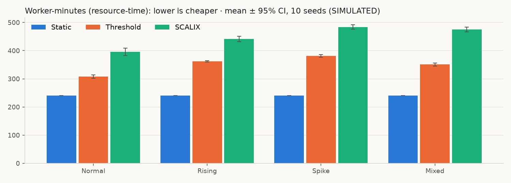
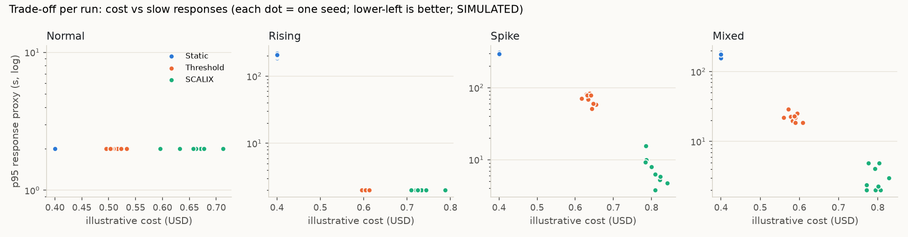

# Evaluation: methodology and results

> **All results in this document are SIMULATED.** They come from the local simulator described in [SIMULATION.md](SIMULATION.md). No result is an AWS measurement. No AWS infrastructure was deployed, and no real cloud performance improvement is claimed. Costs are illustrative: billed worker-time × an assumed USD 0.10 per worker-hour, not an AWS price.

Every number below is copied from the generated file [results/RESULTS_TABLES.md](results/RESULTS_TABLES.md). That file is built by `python -m scalix.evaluation report` from the CSV outputs in `results/experiments/`, and a test checks that it matches those outputs exactly.

## 1. Question and expectation

**Question:** compared with a fixed fleet (Static) and a classic reactive rule (Threshold 70/30), does workload-aware scaling (SCALIX) give a better balance between responsiveness and resource use?

**Expectation stated before running (Phase 1):** acting early and in larger steps should reduce waiting under changing demand, but it also means more workers and so more cost. SCALIX was **not** assumed to win.

## 2. Method

### 2.1 Experiment suite (fixed in code before running)

The suite is defined in `scalix/evaluation.py` (`SUITE`). Every experiment covers 4 scenarios × 3 strategies × **10 seeds (1–10)**, giving 120 runs per experiment and 480 runs in total. Each run lasts 30 minutes of simulated time in 5 s steps, with a decision every 15 s.

| Experiment | What changes | Question |
|---|---|---|
| `main` | nothing (defaults) | How do the three strategies compare? |
| `slow-startup` | new workers take **120 s** to start (default 30 s) | Does the comparison hold with a more realistic EC2 start-up time? |
| `scalix-target-70` | SCALIX's target utilization **0.70** (default 0.60) | Is SCALIX's extra cost caused by its lower target? |
| `scalix-no-additions` | SCALIX **without** spike detection and with scale-down after **1** low interval, i.e. the original Java behaviour | What do the two Python additions contribute? |

### 2.2 Fairness controls

* **Identical traces.** For each (scenario, seed), one workload trace is generated once and given unchanged to all three strategies. `main`, `scalix-target-70` and `scalix-no-additions` share identical traces, so their SCALIX variants can be compared seed by seed.
* **Same start.** Every strategy starts with 8 workers (limits 1–20), the same worker capacity (1 request/s), the same start-up delay and the same price.
* **No cherry-picking.** The seeds and settings were fixed before running. All 480 runs are reported, and none was dropped or re-run.

### 2.3 Workload scenarios


Base demand is 5 requests/s.

| Scenario | Shape |
|---|---|
| Normal | ±25% sine wave around the base rate |
| Rising | Straight line from 2.5 to 12.5 req/s |
| Spike | Base rate, then a sudden jump to 15 req/s at minute 10, then a decline |
| Mixed | All three shapes in sequence |

Arrivals are random (Poisson) around each curve.

### 2.4 Metrics and statistics

These are as defined in [SIMULATION.md](SIMULATION.md#3-metrics-per-run).

* **Worker-time** is billed whether a worker is serving or still starting.
* **Overload** is the time with requests waiting in the queue.
* **The response-time proxy** is 2 s of service time plus the queueing delay from Little's law. It is a formula, not a measured latency.

Cells show the **mean ± the half-width of the 95% confidence interval** (Student t, n = 10). A result is called **clear** only when the best strategy's interval does not overlap any other strategy's interval.

### 2.5 Reproduce

```bash
.venv/bin/python -m scalix.evaluation run
.venv/bin/python -m scalix.evaluation report
```

The first command takes about 10 s. The runs are deterministic, so they produce identical CSVs every time. The second command rebuilds `docs/results/RESULTS_TABLES.md` and `docs/figures/*.png`.

## 3. Results: experiment `main`

| Scenario | Strategy | Resp. avg (s) | Resp. p95 (s) | Overload (s) | Unserved at end | Worker-min | Cost (USD) | Avg util | Peak util | Ups | Downs |
|---|---|---|---|---|---|---|---|---|---|---|---|
| Normal | Static | 2.01 ± 0.01 | 2.00 ± 0.00 | 30 ± 11 | 0 ± 0 | 240 ± 0 | 0.400 ± 0.000 | 63.1% ± 0.6% | 100% ± 0% | 0.0 ± 0.0 | 0.0 ± 0.0 |
| Normal | Threshold | 2.00 ± 0.00 | 2.00 ± 0.00 | 2 ± 3 | 0 ± 0 | 308 ± 6 | 0.513 ± 0.010 | 49.9% ± 0.9% | 95% ± 4% | 4.6 ± 0.5 | 2.2 ± 0.6 |
| Normal | SCALIX | 2.00 ± 0.00 | 2.00 ± 0.00 | 1 ± 2 | 0 ± 0 | 395 ± 13 | 0.659 ± 0.022 | 39.5% ± 1.2% | 89% ± 5% | 4.3 ± 1.0 | 4.6 ± 1.2 |
| Rising | Static | 40.72 ± 2.14 | 206.61 ± 8.61 | 906 ± 31 | 1866 ± 77 | 240 ± 0 | 0.400 ± 0.000 | 80.7% ± 0.4% | 100% ± 0% | 0.0 ± 0.0 | 0.0 ± 0.0 |
| Rising | Threshold | 2.00 ± 0.00 | 2.00 ± 0.00 | 2 ± 2 | 0 ± 0 | 362 ± 2 | 0.604 ± 0.004 | 61.8% ± 0.6% | 98% ± 2% | 12.2 ± 0.3 | 1.2 ± 0.3 |
| Rising | SCALIX | 2.00 ± 0.00 | 2.00 ± 0.00 | 0 ± 0 | 0 ± 0 | 441 ± 9 | 0.735 ± 0.016 | 50.4% ± 1.1% | 86% ± 5% | 7.1 ± 0.7 | 0.2 ± 0.3 |
| Spike | Static | 139.12 ± 4.54 | 294.56 ± 6.50 | 1201 ± 2 | 446 ± 78 | 240 ± 0 | 0.400 ± 0.000 | 87.6% ± 0.4% | 100% ± 0% | 0.0 ± 0.0 | 0.0 ± 0.0 |
| Spike | Threshold | 23.56 ± 2.97 | 71.23 ± 8.07 | 470 ± 20 | 0 ± 0 | 382 ± 5 | 0.636 ± 0.008 | 59.4% ± 0.8% | 100% ± 0% | 9.7 ± 0.3 | 4.1 ± 0.6 |
| Spike | SCALIX | 2.52 ± 0.25 | 7.46 ± 2.45 | 96 ± 13 | 0 ± 0 | 484 ± 8 | 0.807 ± 0.013 | 45.7% ± 1.0% | 100% ± 0% | 4.9 ± 0.5 | 5.0 ± 0.5 |
| Mixed | Static | 51.72 ± 2.29 | 172.50 ± 6.46 | 718 ± 18 | 0 ± 0 | 240 ± 0 | 0.400 ± 0.000 | 77.0% ± 0.5% | 100% ± 0% | 0.0 ± 0.0 | 0.0 ± 0.0 |
| Mixed | Threshold | 5.80 ± 0.56 | 21.97 ± 2.29 | 236 ± 10 | 0 ± 0 | 351 ± 6 | 0.585 ± 0.010 | 53.3% ± 0.7% | 100% ± 0% | 8.4 ± 0.5 | 8.0 ± 0.7 |
| Mixed | SCALIX | 2.09 ± 0.08 | 2.95 ± 0.87 | 42 ± 18 | 0 ± 0 | 475 ± 8 | 0.792 ± 0.014 | 40.1% ± 0.8% | 100% ± 0% | 5.6 ± 0.5 | 6.9 ± 0.6 |

Mean ± 95% CI half-width, 10 seeds, SIMULATED. The full tables, including time above 70% and peak waiting requests, are in [RESULTS_TABLES.md](results/RESULTS_TABLES.md).






### 3.1 What the results show

1. **Sudden changes (Spike, Mixed): SCALIX responded much faster, and the lead is clear.**
   * **Spike:** SCALIX's average response proxy was 2.52 s against Threshold's 23.56 s, about 9.4× lower. Its p95 was 7.46 s against 71.23 s, and overload was 96 s against 470 s.
   * **Mixed:** SCALIX averaged 2.09 s against 5.80 s, with a p95 of 2.95 s against 21.97 s.
   * **Why:** SCALIX scales up as soon as utilization reaches 70%, or from 55% when demand is rising or has spiked. Each step is sized for 60% utilization (up to +3 workers) instead of +1. In the workers-over-time figure, SCALIX reaches its peak capacity minutes before Threshold does.
2. **Calm or gradual changes (Normal, Rising): no responsiveness advantage.** SCALIX and Threshold tie at the 2.00 s floor on both the average and p95 response proxy. Overload was 0–2 s for both.
3. **SCALIX cost more than Threshold in every scenario.**

   | Scenario | Cost premium over Threshold | Extra worker-minutes |
   |---|---|---|
   | Normal | +28.4% | +87 |
   | Rising | +21.7% | +79 |
   | Spike | +26.8% | +102 |
   | Mixed | +35.5% | +124 |

   SCALIX also had the lowest average utilization everywhere (39.5–50.4%).
4. **Static was the cheapest everywhere** (240 worker-minutes, USD 0.400), but it can't follow demand:
   * **Rising:** 1,866 ± 77 requests were still waiting at the end, with a p95 proxy of 206.61 s.
   * **Spike:** 446 ± 78 requests were left waiting, with 1,201 s of overload.

   Its high utilization (up to 87.6%) is not efficiency here: the workers were saturated while requests queued.

## 4. Where SCALIX does not outperform the baselines, and why

| Where | What happened | Explanation |
|---|---|---|
| **Cost and worker-time, all scenarios** | SCALIX was the most expensive strategy every time. | It adds capacity early and in bigger steps (sized for 60%, not 70%), and it removes capacity slowly. Section 5 measures the slow removal from the decision logs. |
| **Utilization, all scenarios** | It had the lowest average utilization. | This follows directly from the above: more headroom means more idle capacity. |
| **Response under Normal and Rising** | SCALIX tied with Threshold (2.00 s). | **Normal:** demand never outgrew Threshold's one-worker steps, so both kept the queue near zero. **Rising:** the rise of about 0.33 req/s per minute was slow enough for +1 steps every 60 s to keep up. Extra headroom bought nothing measurable, but it still cost money. |
| **Scale-downs, Normal** | SCALIX made more scale-downs than Threshold (4.6 vs 2.2). | SCALIX first over-sizes, then trims back. These are corrections, not efficiency. |
| **Proxy limitation** | The response proxy has a floor of exactly 2.00 s whenever no queue forms. | Real servers slow down before the queue overflows. The proxy can't show any benefit SCALIX's extra headroom might give at 60–80% load, so on Normal and Rising the comparison may *understate* SCALIX, and nothing here can show whether it does. |

## 5. Why SCALIX keeps more workers: evidence from the decision logs

Every decision taken while utilization was at or below 30% in experiment `main` (10 seeds), counted by outcome. The counts come from `scale_down_holds.csv`.

| Scenario | Strategy | Low-utilization decisions | Scaled down | Held: reason (count) |
|---|---|---|---|---|
| Normal | SCALIX | 224 | 46 | not low for 2 intervals yet (102), cooldown (68), demand rising (8) |
| Normal | Threshold | 28 | 22 | cooldown (3), other, e.g. exactly at the threshold (3) |
| Rising | SCALIX | 26 | 2 | not low for 2 intervals yet (11), demand trend unknown (7), demand rising (6) |
| Rising | Threshold | 12 | 12 | – |
| Spike | SCALIX | 241 | 50 | cooldown (98), not low for 2 intervals yet (82), demand rising (11) |
| Spike | Threshold | 78 | 41 | cooldown (28), other, e.g. exactly at the threshold (9) |
| Mixed | SCALIX | 428 | 69 | cooldown (229), demand rising (75), not low for 2 intervals yet (50), demand just spiked (5) |
| Mixed | Threshold | 234 | 80 | cooldown (149), other, e.g. exactly at the threshold (5) |

**What this shows:**

1. **SCALIX spends far more decisions at low utilization**, because its scale-ups overshoot: 224 against 28 on Normal.
2. **It then holds most of the time.** The holds come mainly from its **90 s scale-down cooldown**, which also counts from scale-ups, and from the **2-interval "stay low" rule**.
3. **The "would the remaining workers exceed 60%?" check blocked no scale-down at all.** The extra capacity is a consequence of deliberate caution, not of that check.

## 6. Sensitivity experiments

### 6.1 Slow start-up (120 s instead of 30 s)

From the cross-experiment table in [RESULTS_TABLES.md](results/RESULTS_TABLES.md):

| Scenario | Threshold resp. avg / p95 (s) | SCALIX resp. avg / p95 (s) | Overload T / X (s) | SCALIX cost premium |
|---|---|---|---|---|
| Spike | 31.91 / 94.96 | 5.88 / 25.50 | 528 / 232 | +21.2% |
| Mixed | 7.81 / 29.43 | 2.62 / 6.85 | 278 / 132 | +28.5% |

Across all four scenarios, SCALIX's cost premium over Threshold was +16.8% to +28.5% in this experiment.

With slower start-up, both strategies get worse and SCALIX's advantage shrinks. On Spike, its average-response advantage drops from 9.4× to 5.4×. **It doesn't disappear.** Normal and Rising remain ties on response (2.00 s).

### 6.2 SCALIX target 70% instead of 60%

Paired by seed, SCALIX at 70% minus SCALIX at 60%. **Bold** means the 95% interval excludes 0.

| Scenario | Worker-min | Cost (USD) | Overload (s) | Resp. p95 (s) |
|---|---|---|---|---|
| Normal | **−33.7 ± 7.8** | **−0.056 ± 0.013** | +0.0 ± 0.0 | +0.00 ± 0.00 |
| Rising | **−42.3 ± 3.7** | **−0.070 ± 0.006** | +1.0 ± 1.5 | +0.00 ± 0.00 |
| Spike | **−17.6 ± 3.4** | **−0.029 ± 0.006** | **+41.5 ± 7.5** | **+7.90 ± 1.48** |
| Mixed | **−18.1 ± 7.4** | **−0.030 ± 0.012** | **+39.5 ± 18.7** | **+2.75 ± 1.41** |

* **A higher target makes SCALIX cheaper at no response cost on Normal and Rising.** It costs some, but not all, of its spike advantage: on Spike its average proxy is 3.48 s, still far below Threshold's 23.56 s.
* **The target explains only part of the cost gap.** Even at 70%, SCALIX still cost more than Threshold in every scenario: +17.4% Normal, +10.0% Rising, +22.2% Spike, +30.3% Mixed. The rest comes from the bigger steps and the cautious scale-down (section 5).

### 6.3 SCALIX without its two Python additions

Spike detection off, and scale-down after 1 low interval. This is the original Java behaviour. Paired by seed: without additions minus with additions.

| Scenario | Worker-min | Cost (USD) | Overload (s) | Resp. p95 (s) | Scale-downs |
|---|---|---|---|---|---|
| Normal | −4.2 ± 4.2 | −0.007 ± 0.007 | +0.0 ± 0.0 | +0.00 ± 0.00 | **+2.7 ± 0.9** |
| Rising | −1.7 ± 4.7 | −0.003 ± 0.008 | +0.0 ± 0.0 | +0.00 ± 0.00 | **+0.5 ± 0.4** |
| Spike | **−6.0 ± 2.1** | **−0.010 ± 0.003** | **+8.5 ± 7.9** | **+1.53 ± 1.42** | **+0.9 ± 0.5** |
| Mixed | **−9.2 ± 3.3** | **−0.015 ± 0.005** | +4.0 ± 6.3 | +0.66 ± 1.00 | **+1.1 ± 0.5** |

* **The additions' effect is small.** With them, SCALIX makes fewer scale-downs (less flapping) and has a slightly better spike p95 (about 1.5 s), for slightly higher worker-time (6–9 worker-minutes on Spike and Mixed).
* **Most of SCALIX's advantage comes from the original design,** not these additions: early scale-up on a rising trend, and steps sized to a target.
* This experiment switches both additions off together, so it doesn't separate their individual effects.

## 7. Answer to the question

**In this simulation, SCALIX traded money for responsiveness to *sudden* demand.**

* When demand jumped (Spike, Mixed), SCALIX kept waiting times far lower than Threshold. The confidence intervals don't overlap, and the result held with a 120 s start-up delay.
* When demand was calm or rose gradually (Normal, Rising), SCALIX was no faster, but it cost 22–28% more.
* Across all scenarios it was 22–36% more expensive than Threshold and had the lowest utilization.

**So SCALIX is not a better default overall.** It's a better choice when sudden demand changes are common and waiting is expensive. When demand changes slowly, the simpler Threshold rule gave the same service for less.

## 8. Threats to validity

* **Simulated only.** It's a fluid queue model with fixed worker capacity, no request-size variation, no network, no failures and no draining. Real systems may behave differently. See [LIMITATIONS.md](LIMITATIONS.md).
* **The response-time proxy has a floor** and ignores queueing below saturation, so differences under light load aren't visible.
* **Untuned parameters.** Thresholds, targets and cooldowns are starting values. Section 6.2 shows one parameter alone can move SCALIX's cost by 5–10%, so the ranking could change with tuning.
* **Synthetic workloads.** The four scenario shapes and Poisson arrivals are assumptions. Real traffic is often burstier.
* **One model of cost.** USD 0.10 per worker-hour, per-second billing with a 60 s minimum, is illustrative only.
* **Ten seeds.** These give fairly tight intervals for the large effects here. Small differences, such as some in section 6.3, are near the edge of detection.
* **Not cross-validated against the Java engine for whole runs.** The Python *policies* match the Java ones decision for decision (15,000 parity checks). The *simulators* differ (a fluid model here, CloudSim Plus there). The first Java reference run reached the same qualitative conclusions: SCALIX faster under bursts and more expensive everywhere ([PART1_JAVA_ENGINE.md](PART1_JAVA_ENGINE.md)).
