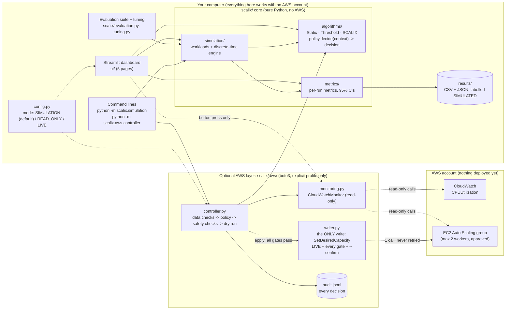

# System architecture (AWS edition)

The original Java / CloudSim Plus engine and its dashboard are described in [ARCHITECTURE.md](ARCHITECTURE.md) and [PART1_JAVA_ENGINE.md](PART1_JAVA_ENGINE.md).

## Diagram



Solid arrows are local calls. Dotted arrows are optional or conditional. The dashboard has **no** arrow to the writer.

If Mermaid doesn't render where you're reading, here's the same picture in text:

```
 dashboard (ui/) ──► simulation ──► algorithms ──► metrics ──► results/*.csv  (SIMULATED)
      │                    ▲
      │ (button only)      │ same policy code
      ▼                    │
 read-only monitor ◄── controller ──► audit log
      │                    │ (dry run unless LIVE + all gates + --confirm)
      ▼                    ▼
 CloudWatch, ASG ◄──── writer: SetDesiredCapacity (one call)
```

## Components

| Component | Responsibility | Depends on |
|---|---|---|
| `scalix/algorithms` | Three policies, plus a model of AWS's target tracking for comparison, sharing one interface: `decide(ScalingContext) -> ScalingDecision`. Pure functions with no clock, network, Streamlit or AWS. | nothing else in SCALIX |
| `scalix/simulation` | Workload scenarios (seeded Poisson arrivals), a discrete-time fluid-queue engine with start-up delay, and an experiment runner that feeds identical traces to every policy. | algorithms, metrics |
| `scalix/metrics` | Per-run metrics (utilization, worker-time, events, overload, queueing-model response time, cost from AWS list prices with T3 credits) and statistics across seeds (mean, std, 95% Student-t CI). | pandas, NumPy |
| `scalix/evaluation.py` | The fixed experiment suite (seeds 1–10 and 27 NASA days) and the generated report (tables and figures). | simulation, metrics, tuning |
| `scalix/tuning.py` | Tunes each strategy on training seeds 101–110 (never the test seeds). | simulation |
| `scalix/pricing.py` | AWS list prices behind the cost estimate (t3.micro, us-east-1). | – |
| `scalix/simulation/nasa.py`, `data/traces/` | The NASA July 1995 real-traffic trace, as request counts per 5 s. | – |
| `aws/cloudformation/scalix-workers.yaml` | The Phase 8 test stack: VPC, launch template, Auto Scaling group with max 2 t3.micro workers. You create and delete it yourself in the AWS Console. | – |
| `scalix/config.py`, `sources.py` | Run mode and AWS names (never credentials); the SIMULATED / MOCKED / LIVE_AWS labels. | YAML |
| `scalix/aws/session.py` | Sessions from an explicit named profile only. Every client gets an operation guard (read-only allowlist). Error hints and redaction. | boto3 (optional) |
| `scalix/aws/monitoring.py` | Reads group state and CPU. Judges every reading OK / STALE / MISSING / MALFORMED / ERROR; missing is never 0%. Also has a mock monitor. | session |
| `scalix/aws/controller.py` | One decision per run: data checks → policy → action checks → dry run, or one gated write. | monitoring, algorithms, audit |
| `scalix/aws/writer.py` | The only code that can change AWS: `SetDesiredCapacity`, LIVE mode only, re-checked at the moment of use. | session |
| `scalix/aws/audit.py` | Append-only JSON-lines log. It's the controller's memory for cooldowns and duplicates. | – |
| `ui/` | Local Streamlit dashboard. Reads AWS only on a button press. When the config file enables LIVE, it can approve one change through `scalix/aws/approval.py` (typed confirmation, same gates, kill switch on afterwards). | everything above; the writer only through `approval.py` |

## Why it's built this way

1. **The policy is a pure function, so it can be reused.** The exact code evaluated in simulation is the code the AWS controller would run. Nothing has to be rewritten for the cloud, so there's no "works in the simulator, different in production" gap.
2. **The simulator and AWS are interchangeable sources of a `ScalingContext`.** The simulator builds it from its model, and the controller builds it from CloudWatch. Algorithms never know which.
3. **Safety lives outside the algorithms.** Allowlists, caps, cooldowns, kill switch and confirmation are in the controller and writer, so a policy bug can't bypass them.
4. **Fair comparison is built in.** One trace per (scenario, seed) is handed unchanged to every policy, with the same starting capacity and the same model settings.
5. **Optional dependencies stay optional.** `import scalix` never loads boto3, so the core project runs anywhere with `requirements.txt` only.

## Safety layers for AWS

Each layer is enforced separately and tested:

| Layer | Where |
|---|---|
| SIMULATION by default; the mode is never read from environment variables | `config.py` |
| Explicit named profile; ambient credentials ignored | `session.make_session` |
| Read-only operation guard on every read client | `session.guard_operations` |
| Missing, stale or malformed data means HOLD, never 0% | `monitoring.evaluate_cpu_datapoints`, controller data checks |
| Exact-name group allowlist, approved max 2, max step 1, controller cooldown, duplicate and unresolved-action block, lock | controller action checks |
| LIVE + `live.enabled` + kill switch off + `--confirm <group>` + live data + not on EC2 | controller live gates |
| Writer can call only `SetDesiredCapacity`, and re-checks group, bounds and kill switch | `writer.py` |
| APPLYING written before the call, result after, never retried | controller + `audit.py` |
| Dashboard has no path to writes (static scan + booby-trap tests) | `tests/test_ui.py`, `tests/test_controller.py` |
